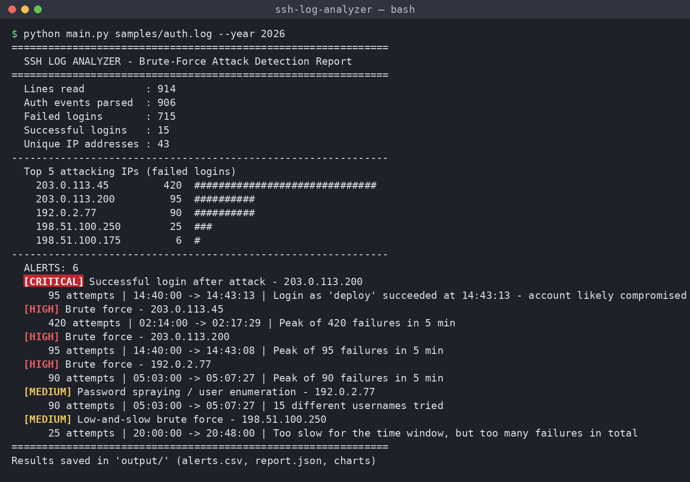
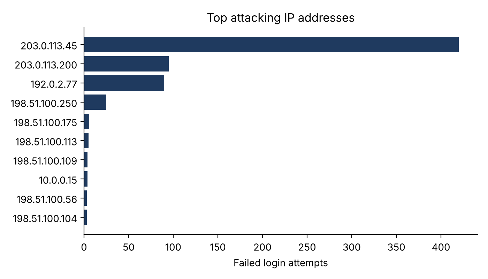

# SSH Log Analyzer — Brute-Force Attack Detection

A Python command-line tool that reads a Linux SSH authentication log (`/var/log/auth.log`), detects brute-force attacks and suspicious logins, and produces a report with statistics, alerts and charts.

> Mini project — Python Programming (24CAH-301), Chandigarh University
> Author: Souleymane Doumbia (24BCA10655)

## Features

- **Log parsing** with regular expressions (failed logins, successful logins, invalid users)
- **4 detection rules**

  | Rule | Severity | Trigger (default) |
  |---|---|---|
  | Brute force | HIGH | ≥ 10 failed logins from one IP within 5 minutes (sliding window) |
  | Password spraying / user enumeration | MEDIUM | one IP tries ≥ 5 different usernames |
  | Low-and-slow brute force | MEDIUM | ≥ 20 failed logins in total, too slow for the time window |
  | Successful login after attack | CRITICAL | an attacking IP finally logs in → account likely compromised |

- Colored terminal summary
- Export to **CSV** (`alerts.csv`) and **JSON** (`report.json`)
- **Charts**: top attacking IPs, failed logins per hour, most targeted usernames
- **Unit tests** with pytest
- Sample log generator (attacker IPs use RFC 5737 documentation ranges, never real hosts)

## Project structure

```
ssh-log-analyzer/
├── main.py                    # command-line entry point
├── log_analyzer/
│   ├── models.py              # LogEvent and Alert dataclasses
│   ├── parser.py              # regex parsing of auth.log
│   ├── detector.py            # BruteForceDetector (4 rules)
│   └── reporter.py            # statistics, terminal output, CSV/JSON, charts
├── tools/generate_sample_log.py
├── samples/auth.log           # sample log (914 lines)
├── tests/                     # pytest unit tests
└── docs/                      # screenshots and example charts
```

## Installation

```bash
git clone https://github.com/s-doumbia-cyber/ssh-log-analyzer.git
cd ssh-log-analyzer
pip install -r requirements.txt
```

Requires Python 3.8+.

## Usage

```bash
# analyze the sample log
python main.py samples/auth.log --year 2026

# custom thresholds and output folder
python main.py /var/log/auth.log --threshold 15 --window 10 --spray 8 --total 30 --out results

# regenerate the sample log
python tools/generate_sample_log.py --out samples/auth.log

# run the tests
python -m pytest
```

| Option | Default | Meaning |
|---|---|---|
| `--threshold` | 10 | failed logins inside the window that trigger a brute-force alert |
| `--window` | 5 | sliding window in minutes |
| `--spray` | 5 | distinct usernames that trigger a spraying alert |
| `--total` | 20 | total failures that trigger a low-and-slow alert |
| `--year` | current year | auth.log lines have no year |
| `--out` | `output` | folder for CSV, JSON and charts |
| `--no-color` | off | plain terminal output |

## Example output





## How detection works

1. Every line is matched against three regular expressions. Lines that do not match (cron, system messages) are ignored.
2. Failed logins are grouped by IP address.
3. For each IP, a **sliding window** (a `deque`) keeps only the failures of the last *N* minutes; if the window ever holds ≥ threshold failures, the IP is flagged.
4. IPs that are too slow for the window but exceed the total limit are flagged as low-and-slow.
5. If an IP that was flagged later appears in a successful login, a CRITICAL alert is raised.

## Limitations

- Supports the OpenSSH `auth.log` format (Debian/Ubuntu). RHEL-based systems use `/var/log/secure` with the same message format.
- Offline analysis: it reads a file, it does not block IPs in real time (see Fail2ban for that).
- A distributed attack using many IPs, each with few attempts, can stay under every per-IP threshold.

## License

MIT
